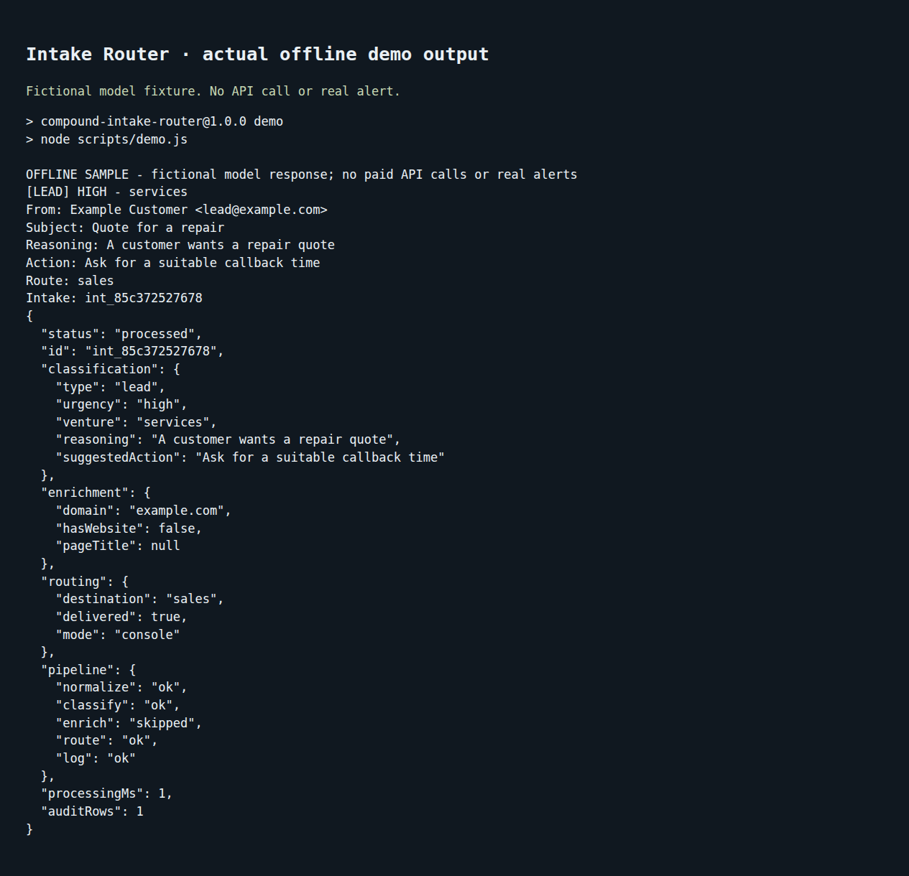

# Compound Intake Router

**Turn an inbound enquiry into a suggested next action for your small service business.**

Send a lead from a form or inbox automation to one HTTP endpoint. Claude suggests a message type, business group, urgency and next action. Your rules choose the destination; optional Slack, email or webhook alerts tell you to review it. SQLite keeps the intake and its outcome.



This is a self-hosted service for a technically assisted buyer. It has no dashboard or inbox connector. AI suggestions need human review.

## What it replaces and leaves out

For the narrow job of classifying a lead and alerting a person, it can replace a dedicated Zapier or Make automation, or a HubSpot-style lead-routing rule.

| Included | Left out compared with the paid platforms |
|---|---|
| One JSON endpoint and configurable classification | Form builders, inbox sync and app-connector marketplaces |
| Business-group routes and one alert adapter | Drag-and-drop workflows, round-robin assignment and multi-step orchestration |
| SQLite history | CRM contacts, sales pipelines, campaigns and reporting dashboards |
| Optional shared inbound bearer token | Accounts, tenant isolation, user permissions and a full public API gateway |

There is **no durable delivery queue, automatic retry or duplicate-request protection**. A remote 2xx means acceptance, not that a person read an alert. Do not use this for emergency or guaranteed delivery.

## Five-minute offline demo

Requires Node.js 22+ and npm. Native SQLite may need a C++ build toolchain.

```sh
git clone https://github.com/OrionArchitekton/compound-intake-router.git
cd compound-intake-router
npm ci
npm test
npm run demo
```

The demo prints `OFFLINE SAMPLE`. It uses fictional input and a fixed model response, exercises parsing/routing and a temporary SQLite audit row, then removes that temporary database. No API key, enrichment requests or real alerts. It does not prove live Claude accuracy.

## Your first real enquiry

Copy `.env.example` to `.env` and supply your own Anthropic key. Provider usage is billed separately. Start with `DELIVERY_MODE=console` and `ENABLE_ENRICHMENT=false`. Set a private `INTAKE_TOKEN`; configure your caller to send `Authorization: Bearer <your token>`. Run `npm start` and POST JSON to `http://127.0.0.1:3747/intake`:

```json
{
  "sender": { "name": "Example Customer", "email": "lead@example.com" },
  "subject": "A repair quote",
  "body": "Can you quote a small repair this week?",
  "source": "contact-form"
}
```

The response includes `id`, `classification`, `routing`, per-stage `pipeline` status and processing time. Invalid input returns 400; a missing/invalid configured token returns 401. Check `pipeline.log` and `routing.delivered`, not just HTTP 200. `npm run view-log` reads recent local audit rows. See the [Docker/Render guide and rollback runbook](docs/runbooks/deploy.md).

## Choose your categories

Edit `config/service-business.json` or point `INTAKE_CONFIG` at your JSON profile. Define message types, business groups, descriptions and deterministic route labels. Retain `unknown` and `general` as manual-review fallbacks; restart after changing a profile. Invalid model IDs go to manual review. Spam is logged without alert delivery.

For compatibility, the response and SQLite schema still call the business group `venture`. The original categories and rules are available in `config/venture-studio.json`. The old separate files remain examples; the selected combined profile controls the app.

## Pick one alert adapter

| `DELIVERY_MODE` | Required settings | What success proves |
|---|---|---|
| `console` (default) | None | Alert text written to process stdout |
| `slack` | `SLACK_WEBHOOK_URL` | Slack accepted a post to the incoming webhook's configured channel |
| `email` | `RESEND_API_KEY`, `ALERT_EMAIL_FROM`, `ALERT_EMAIL_TO` | Resend accepted a plain-text email; verify your sender domain |
| `webhook` | `ALERT_WEBHOOK_URL` | Your receiver accepted structured JSON |

Email recipients may be comma-separated. A single selected adapter uses one physical destination (or email recipient list) for all route labels. Labels such as `sales` appear in the alert; they do not change Slack's channel or the email recipient. A webhook receiver can use them downstream. Transports plug into the small adapter map in `src/delivery.js`.

Destinations are operator settings, never lead/model output. Remote URLs require HTTPS; loopback HTTP works for tests. Sends time out after five seconds and reject redirects. Failures stay `delivered: false`; there is no disguised console success or automatic resend.

## Privacy and limits

Accepted raw payloads and classification results persist in `data/intakes.db`. Treat the DB, backups and console output as private customer data; the app does not encrypt them. Claude receives sender context, subject and about 3,000 body characters. [Anthropic's retention terms](https://privacy.claude.com/en/articles/7996866-how-long-do-you-store-my-organization-s-data) apply. Alert providers also receive alert content.

Website enrichment is off by default. Enabling it fetches a sender-supplied domain and follows redirects; appropriate network egress restrictions are required. Keep it off for ordinary hosted setups. Loopback is the default bind; non-local binding requires `INTAKE_TOKEN`. Add HTTPS, gateway rate/body limits, provider budget limits and monitoring before internet exposure. No built-in usage quota or customer billing.

## Done-for-you setup (proposal)

**Price TODO; suggested $499 USD one-time.** Proposed scope: one business profile, one deployment, one inbound source connected by the buyer, one alert destination, a synthetic acceptance test and a 60-minute handoff. Hosting, API/email usage, provider accounts and ongoing support are separate. Dan must approve scope, price and availability before sale. No checkout yet; see [SWAPMEET.md](SWAPMEET.md).

## Development and license

`npm test` uses Node's built-in test runner and no production credentials. Tests include HTTP-to-webhook-to-SQLite and failed-delivery/privacy cases. `npm run demo:live` retains the old five-request driver: it needs a running server and may incur API cost/send alerts; never treat it as an offline test. [MIT](LICENSE) is retained. See the [behavior spec](specs/service-business-intake-spec.md).
